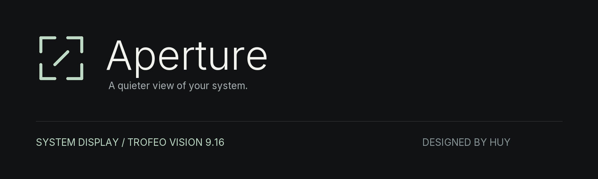
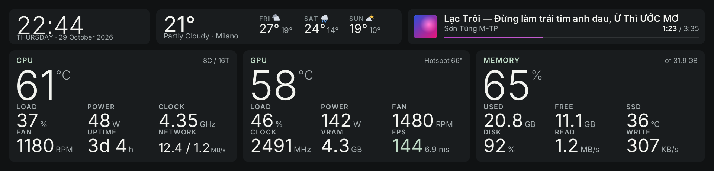
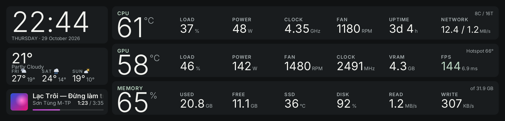
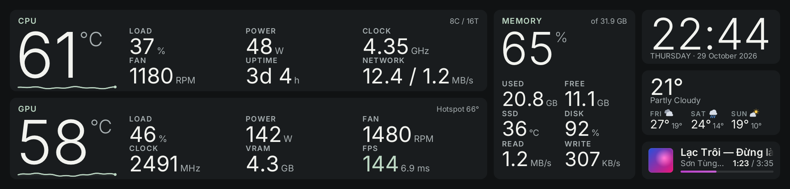
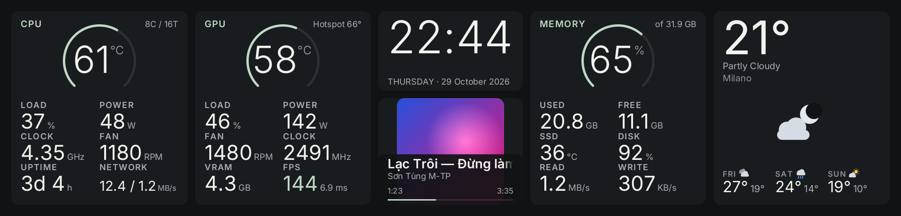
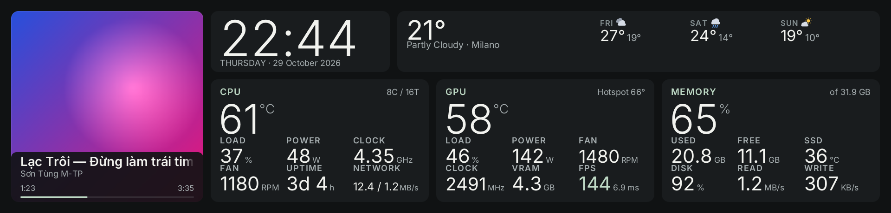

<p align="center"></p>

<p align="center"><b>A native system display for the Thermalright Trofeo Vision 9.16″.</b><br>Large type. Complete readings. A little less noise.</p>

<p align="center"><a href="#the-collection">The collection</a> · <a href="#get-started">Get started</a> · <a href="docs/CONFIGURATION.md">Configuration</a> · <a href="docs/DEVELOPMENT.md">Build & contribute</a></p>

## The collection

Five new compositions built for the panel's unusually wide 1920 × 462 canvas. A shared information model keeps CPU fan, GPU hotspot, VRAM and FPS in dedicated positions. Focus and Grid remain available alongside them.

| Layout | Composition |
| :-- | :-- |
| **Axis** | A shallow context bar above three equal hardware instruments. |
| **Ledger** | Three precise hardware rows with a separate context column. |
| **Duet** | CPU and GPU across two wide stages; memory has its own rail. |
| **Orbit** | Fine gauge arcs around the hardware numbers; a central clock and music column. |
| **Atelier** | Album art leads, with a complete hardware desk alongside it. |







*Images are rendered by the program using sample data, not measurements from a live PC.*

**Five quiet palettes:** Mineral, Frost, Blush, Sand and Iris. Neutral surfaces, readable secondary text and one coordinated accent. Temperature warnings keep their own semantic colors. Pick a custom accent if you prefer; dark accents are lifted for legibility. Existing layout and palette keys still work, with older landscape designs grouped separately in the settings app.

## What you can see

- **CPU:** temperature, load, power, clock, fan RPM, uptime and network throughput.
- **GPU:** temperature, hotspot, load, power, fan, clock, VRAM and FPS with frame time.
- **Memory & storage:** memory use, free memory, SSD temperature, disk capacity use and read/write throughput.
- **Context:** clock, date, current weather, a three-day forecast, album art, track title, artist and elapsed/total time.

Readings depend on the hardware and sensor source. Unavailable sensors show `--`; they are never replaced with invented values. The display does not replace VRAM with FPS when a game starts.

## Get started

### Windows

1. Download **`aperture-windows.zip`** from [Aperture releases](https://github.com/HuyBruh/Aperture/releases/latest). The source ZIP is for developers and contains no executable.
2. Extract the entire package into a permanent folder. Close Thermalright TRCC so it releases the USB display.
3. Run **`Aperture.bat`** to open settings. Run **`scripts/install.bat`** if you want sensor-driver setup and automatic startup. Windows may ask for elevation.
4. Select a layout and palette. Settings are saved in `trofeo.conf` and picked up by the display program.

The package contains two executables: `aperture.exe` for settings, and `aperture-display.exe` for the USB display. The display service is now named `ApertureDisplay`. Existing `trofeo.conf` settings remain supported; the installer replaces the previous scheduled task.

**Upgrading from HuyBruh Dash:** back up your current folder and keep your existing `trofeo.conf`. The new default configuration is only for fresh installs. See [migration](docs/MIGRATION.md) before replacing a running installation.

### Sensors

| Reading | Source |
| :-- | :-- |
| CPU temperature / power | PawnIO on supported AMD/Intel CPUs; external sensor fallback |
| CPU fan / additional temperatures | LibreHardwareMonitor or HWiNFO |
| GPU telemetry | GPU interfaces and supported external sensor sources |
| DirectX FPS | ETW; elevated permissions may be required |
| Weather | Open-Meteo; a configured city or IP-based location |
| Now playing | Windows media controls; `playerctl` on Linux |

Open **Sensors & help** to inspect status and select the CPU fan. Availability varies by machine. Weather needs an internet connection.

### Linux / build from source

See [development](docs/DEVELOPMENT.md) for prerequisites and commands. The new collection shares the existing software renderer and USB driver; this rework does not introduce a web runtime.

## Project structure

```text
src/dashboard/       Aperture collection renderer and generated geometry
design/              Canonical layout geometry and palette specifications
assets/brand/        Vector mark and application icons
windows/             Portable defaults, launchers and installation scripts
tools/               Design generation, checks, rendering and packaging
docs/                Configuration, migration, development and release evidence
```

Legacy renderers and upstream integrations remain in `src/` for compatibility. The new collection is isolated so a layout change does not require changes to sensor collection or the USB protocol.

## Performance & validation

The 3.x performance measurements were for older layouts on one PC at idle. They are [preserved as history](docs/history/v3.3-README.md), not presented as benchmarks of this rework. A fresh measurement is required before claiming a CPU or RAM budget for Aperture.

See [validation](docs/VALIDATION.md) for the exact checks performed and remaining hardware coverage. A successful preview render verifies the renderer, not every physical LCD or sensor configuration.

## Credits & license

By **Huy**, previously HuyBruh Dash. Built on [haven80/trofeo-lcd-rs](https://github.com/haven80/trofeo-lcd-rs), [sukualam/trofeo-lcd](https://github.com/sukualam/trofeo-lcd) and the protocol work in [Lexonight1/thermalright-trcc-linux](https://github.com/Lexonight1/thermalright-trcc-linux). AI-assisted implementation includes Claude and Codex. Full provenance is in [NOTICE.md](NOTICE.md).

Inter and Chakra Petch are distributed under the SIL Open Font License; their notices remain in `assets/`. **[GPL-3.0-or-later](LICENSE)**. Not affiliated with Thermalright.
