<div align="center">

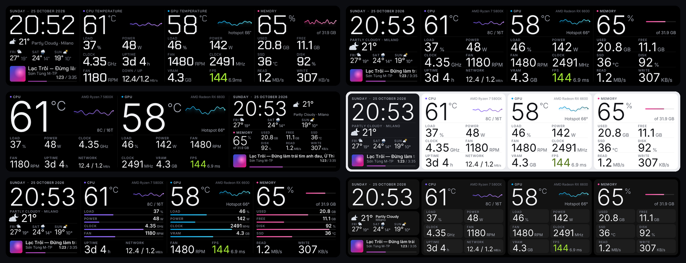

# HuyBruh Dash

**A clean, fast system dashboard for the Thermalright Trofeo Vision 9.16″ LCD.**<br>
25 layouts · a friendly settings app (English / Tiếng Việt) · CPU / GPU / RAM / SSD / network · FPS · weather · now playing

[](../../releases/latest)
[](LICENSE)
[](#install)
[](https://www.rust-lang.org/)

[**Download**](../../releases/latest) · [What's new](#whats-new) · [Layouts](#layouts) · [The app](#the-app) · [Install](#install) · [FAQ](#faq)

</div>

---

## What it is

The official software is heavy and gives you one look. **HuyBruh Dash** is a small native program (Rust,
no browser, no runtime) that drives the panel directly over USB. It shows the same complete set of
readings on every layout, and you change everything in a clean settings window: no config files, no
console menus.

Every layout shows:

- the date and the clock
- the weather with a 3-day forecast
- the CPU: temperature, load, power, clock, fan, uptime and network
- the GPU: temperature, hotspot, load, power, fan, clock, VRAM, and FPS with frame time
- memory, SSD temperature, disk usage and read / write speed
- the song playing, with its cover, elapsed / total time and progress

## What's new

### 3.1: the creative collection

Four more expressive layouts, still with the full set of readings and large text:

- **Pulse:** the CPU and GPU temperature history runs as soft waves behind the big numbers.
- **Ambient:** the album cover colors the whole screen, with a large cover and the readings on a frosted glass panel. With no music, the background is a gradient of your theme.
- **Poster:** the CPU temperature as one giant number running off the edge, magazine style.
- **Horizon:** the sky changes with the time of day, and the sun or moon moves along a 24-hour track.

### 3.0

- **The clean collection.** Seven new minimal layouts: Studio, Grid, Line, Split, Meter, Glance and Daylight. They use the Inter typeface on a strict grid, with even spacing and the same large sizes as Focus.
- **The HuyBruh Dash app replaces the console menus.**
  - Live preview of the display.
  - A gallery of every layout with thumbnails.
  - Colors (or your own color), flip 180°, brightness, 12 / 24 h clock, weather city.
  - Game mode, night mode and heat alert.
  - English or Vietnamese. Every change shows on the display instantly.
- **Sensors & help page.** It says where each reading comes from and fixes the common problems: it installs PawnIO, picks the right CPU fan, restarts the display and explains a blank screen.
- **Intel CPUs.** Temperature and power now work through PawnIO, which the installer installs for you.
- **CPU fan and GPU hotspot from LibreHardwareMonitor** (free, no time limit) or HWiNFO, refreshed every second.
- **A smarter installer.** It checks that the display is connected, closes Thermalright TRCC and warns about the wrong download.
- **A start-up logo** for two seconds when the display starts.
- **Removed:** the 2.0 "fun" layouts. They looked busy and did not meet the bar.

## Performance

The dashboard only redraws when something on screen actually changes (about once per second when idle), so it stays out of your way.

Measured on Windows 11 with a Ryzen 7 5700X3D (8 cores / 16 threads) and a Radeon RX 6900 XT, 30 seconds per layout, idle desktop (no game, no music playing). CPU time of all `trofeo_lcd.exe` processes:

| Layout | % of one thread | % of whole CPU |
|---|---:|---:|
| Focus | 7.1 | 0.45 |
| Bento | 7.4 | 0.46 |
| Dots | 7.3 | 0.46 |
| Equalizer | 7.8 | 0.49 |
| Blueprint | 8.2 | 0.51 |
| Terminal | 9.0 | 0.56 |
| Receipt | 10.0 | 0.63 |
| Chamfer | 10.2 | 0.64 |
| Synthwave | 10.2 | 0.64 |
| Classic | 10.3 | 0.64 |
| Lock | 11.7 | 0.73 |
| Cockpit | 13.2 | 0.83 |
| Rings | 14.3 | 0.90 |

Memory use is roughly 24-35 MB. Even the busiest layout stays under 1% of the whole CPU. Numbers will differ a little on other machines and while music or a game is running.

The clean collection (3.0) draws the same way and has not been measured separately yet.

## Layouts

### The creative collection

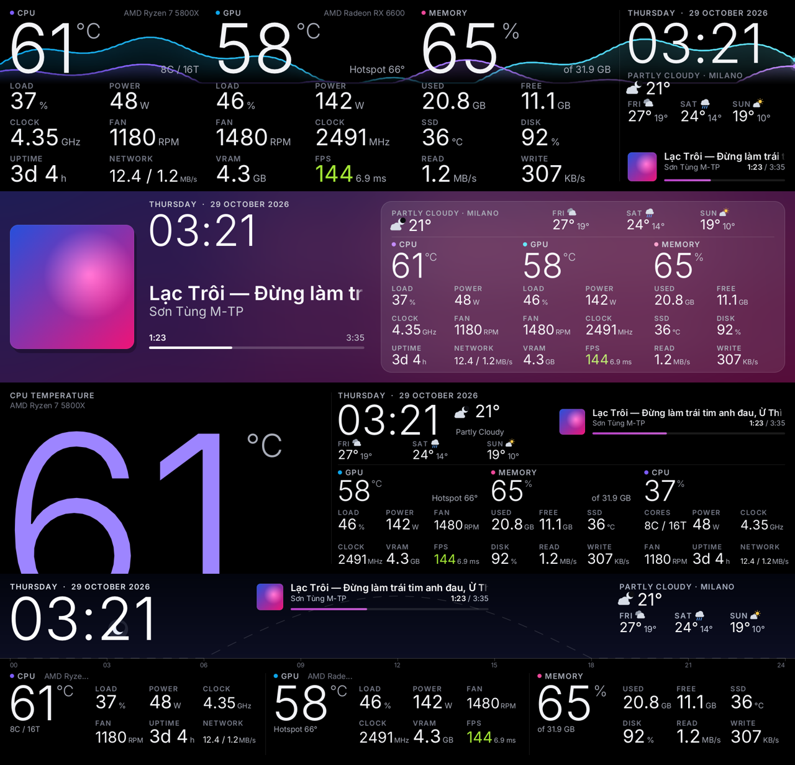

<table>
<tr><td align="center" width="50%">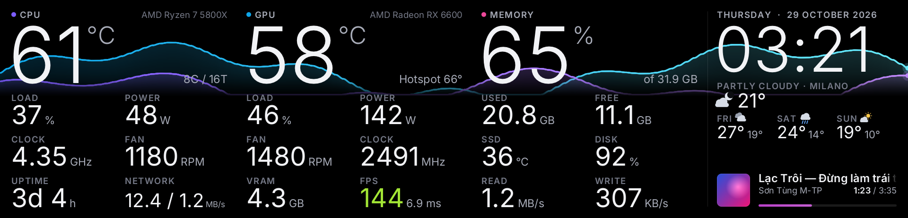<br><b>Pulse</b><br><sub>temperature waves behind the big numbers</sub></td><td align="center" width="50%">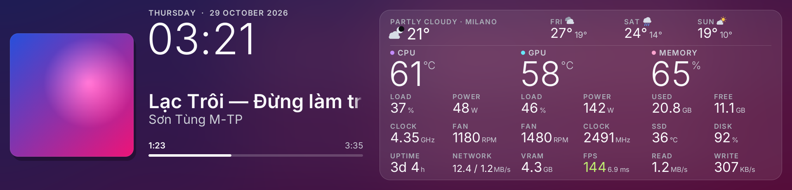<br><b>Ambient</b><br><sub>the album cover lights the screen</sub></td></tr>
<tr><td align="center">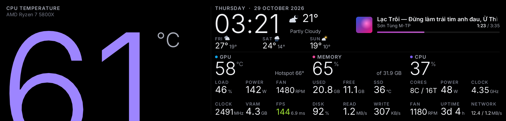<br><b>Poster</b><br><sub>one giant number, magazine style</sub></td><td align="center">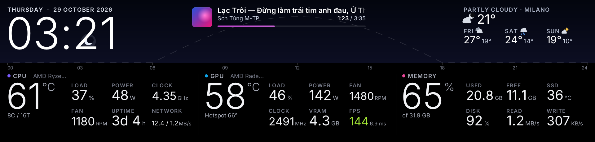<br><b>Horizon</b><br><sub>the day as a sky, sun on a 24 h track</sub></td></tr>
</table>

### The clean collection

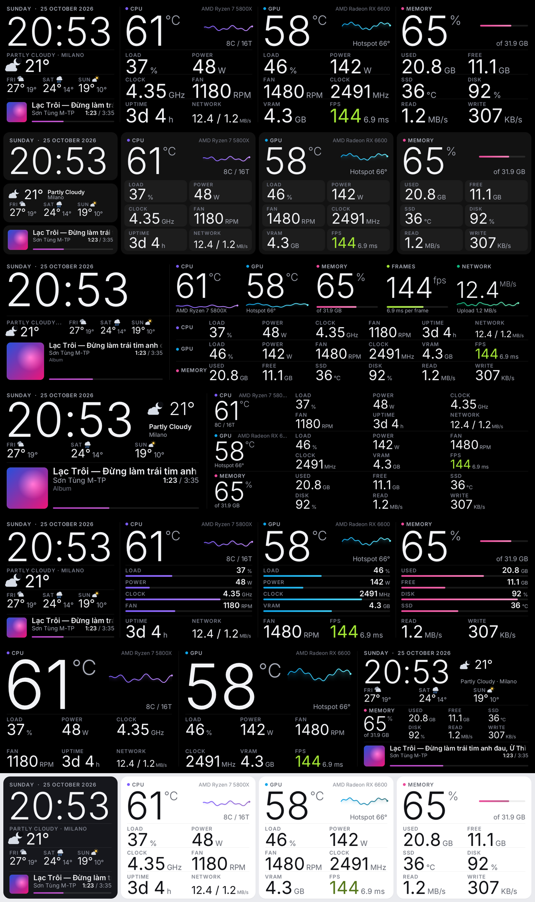

<table>
<tr><td align="center" width="50%">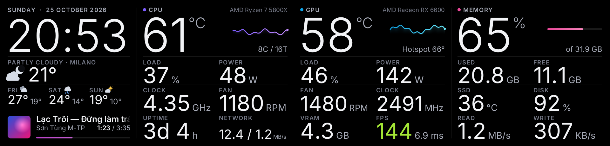<br><b>Studio</b><br><sub>four columns on one grid, hairline tables</sub></td><td align="center" width="50%">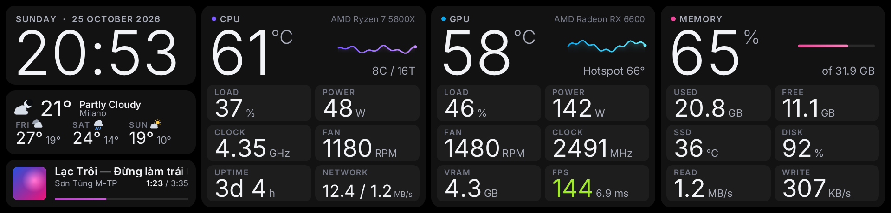<br><b>Grid</b><br><sub>rounded tiles like phone widgets</sub></td></tr>
<tr><td align="center">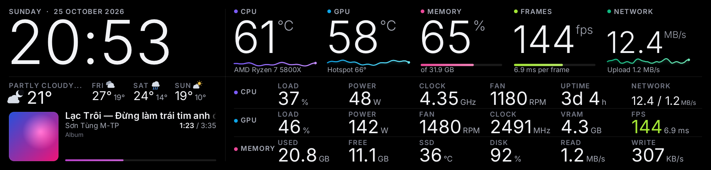<br><b>Line</b><br><sub>five hero numbers with trend lines, one row per section</sub></td><td align="center">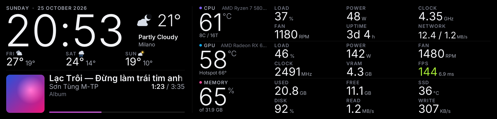<br><b>Split</b><br><sub>big clock and music on the left, stat rows on the right</sub></td></tr>
<tr><td align="center">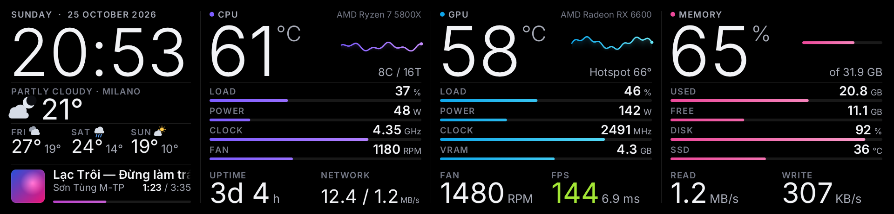<br><b>Meter</b><br><sub>thin bar meters, easy to scan</sub></td><td align="center">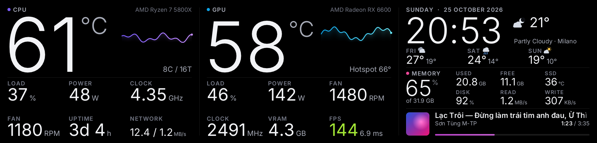<br><b>Glance</b><br><sub>the two temperatures, readable across the room</sub></td></tr>
<tr><td align="center">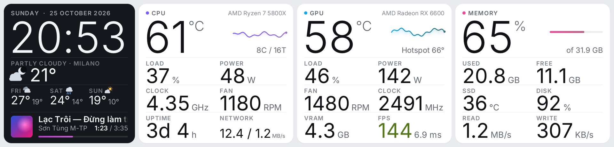<br><b>Daylight</b><br><sub>light mode, white cards</sub></td><td align="center">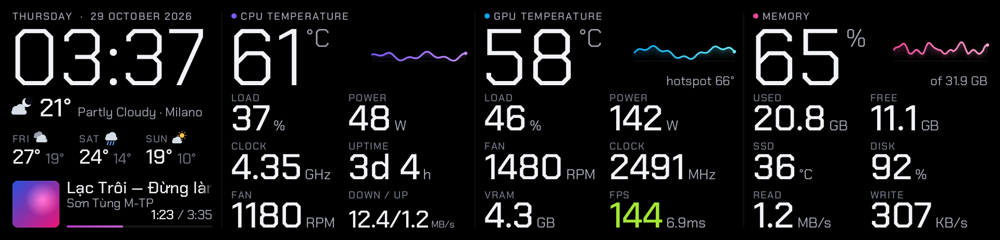<br><b>Focus</b><br><sub>giant digits, the original favorite</sub></td></tr>
</table>

### More landscape layouts

| | |
|---|---|
| **Swiss** — Swiss typographic grid.<br>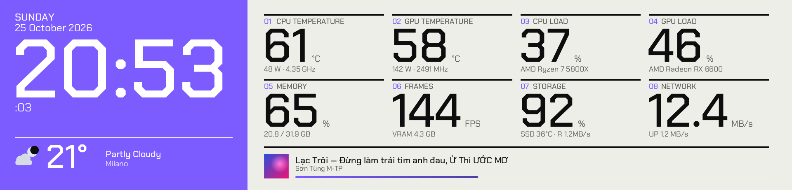 | **Classic** — rounded cards (*cards*, *glass*, *flat*).<br>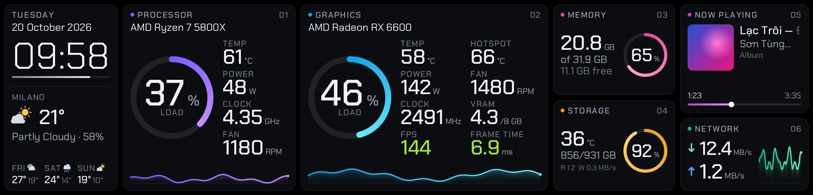 |
| **Cockpit** — twin gauges, clock in the middle.<br>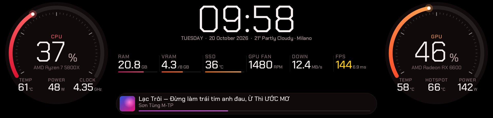 | **Bento** — colorful tiles.<br>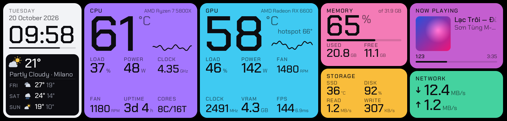 |
| **Terminal** — green console with ASCII bars.<br>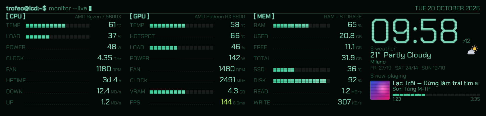 | **Chamfer** — angular game HUD.<br>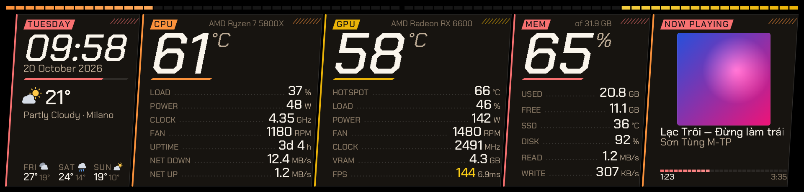 |
| **Rings** — activity rings.<br>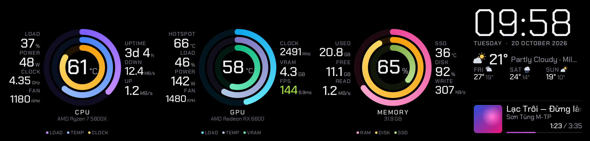 | **Dots** — LED dot matrix.<br>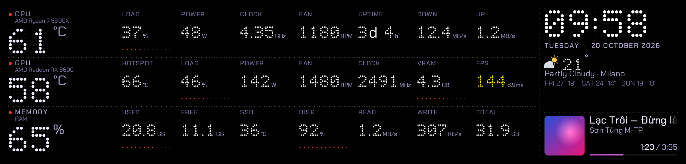 |

### Portrait (vertically mounted display)

<table><tr>
<td align="center">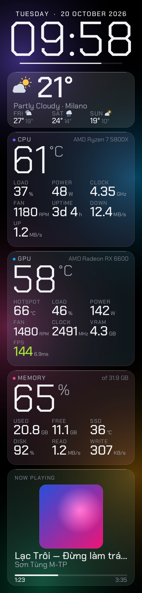<br><b>Lock</b></td>
<td align="center">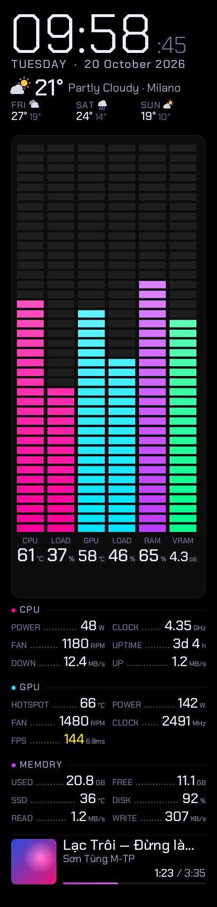<br><b>Equalizer</b></td>
<td align="center">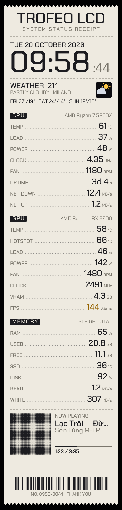<br><b>Receipt</b></td>
<td align="center">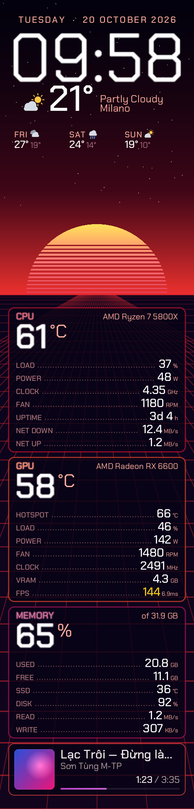<br><b>Synthwave</b></td>
<td align="center">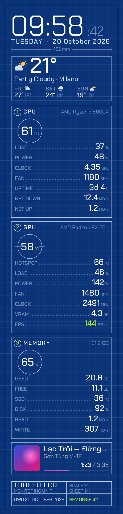<br><b>Blueprint</b></td>
</tr></table>

### Color themes

NZXT, Graphite, Crimson, Arctic, Ember, Neon, or any color you pick (the app builds a matching palette).

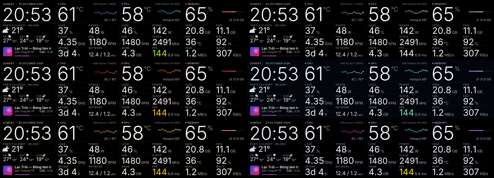

## The app

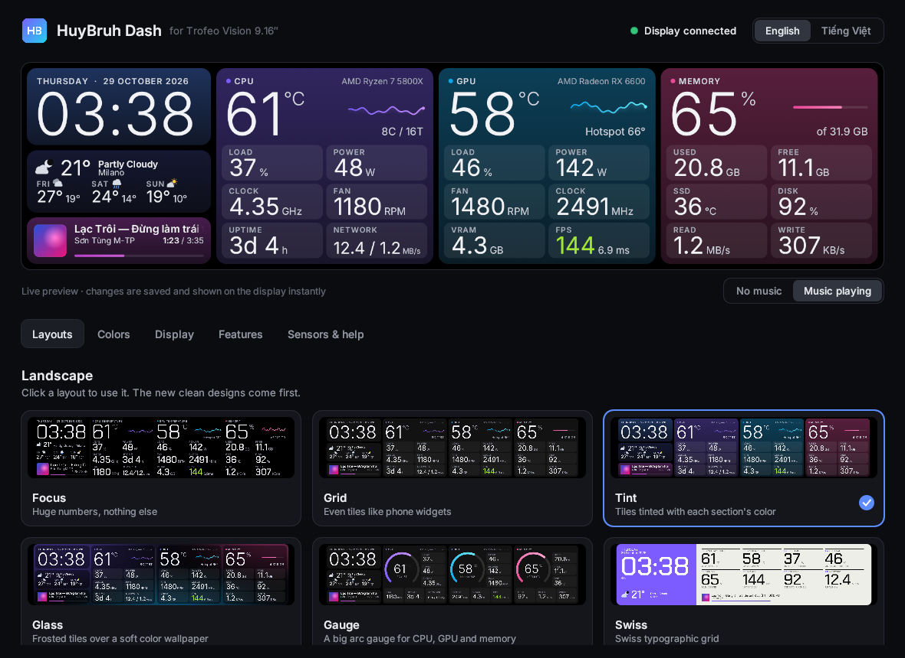 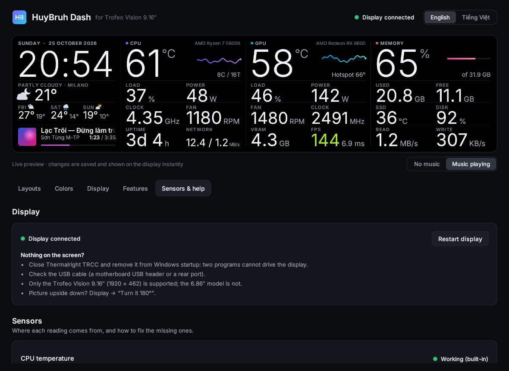

Open **HuyBruh Dash** from the desktop shortcut or `HuyBruh Dash.bat`. It has five pages:

- **Layouts:** every layout with a thumbnail. You can also rotate through all of them.
- **Colors:** six themes, your own color, the panel style, and whether colors follow the album cover.
- **Display:** flip 180° (for a panel mounted upside down), brightness, portrait turn direction, 12 / 24 h clock, °C / °F and the weather city.
- **Features:**
  - new-song pop-up
  - game mode: switches layout and colors while a game shows FPS
  - night mode: dims the display and can change colors during the hours you set
  - heat alert: a red frame pulses above the temperature you choose
- **Sensors & help:**
  - display status, and why a screen might stay blank
  - where each reading comes from
  - one-click PawnIO install
  - CPU fan picker and restart button

## Install

### Windows

1. Download **`huybruh-dash-windows.zip`** from [Releases](../../releases/latest). Do *not* use "Code → Download ZIP": that is the source code and has no program in it.
2. Unzip it anywhere and close Thermalright TRCC.
3. Double-click **`install.bat`** and accept the UAC prompt. It does six things:
   - checks that the display is found
   - closes TRCC
   - installs the PawnIO sensor driver
   - starts the dashboard now and at every logon
   - creates a desktop shortcut
   - opens HuyBruh Dash

Optional extras:

- **CPU fan speed:** run [LibreHardwareMonitor](https://github.com/LibreHardwareMonitor/LibreHardwareMonitor/releases/latest) (free) and turn on *Options → Remote Web Server → Run*. HWiNFO also works with *Settings → Shared Memory Support*.
- **FPS:** works on its own with DirectX games (the autostart task runs as Administrator).

The program is not code-signed, so SmartScreen may warn you. The source is right here if you prefer to build it yourself.

### Linux

Needs `pkg-config`, PulseAudio headers and `playerctl` (song titles). For USB access without `sudo`, install `99-trofeo-lcd.rules`.

```bash
cargo build --release
./target/release/trofeo_lcd          # the display
./target/release/huybruh_dash        # the settings app
```

## Configure by hand (optional)

Everything the app changes lives in `trofeo.conf` next to the program and is re-read every second.

```ini
layout       = pro
pro_layout   = studio        # focus pulse ambient poster horizon studio grid line split meter glance daylight swiss classic cockpit bento
                             # terminal chamfer rings dots | lock equalizer receipt synthwave blueprint | all
pro_theme    = nzxt          # nzxt graphite crimson arctic ember neon all  or  #RRGGBB
flip         = false         # true if the picture is upside down
pro_clock    = 24h           # or 12h
pro_game_layout = focus      # game mode
pro_night    = 22:00-07:00   # night mode (+ pro_night_dim, pro_night_theme)
pro_alert_cpu = 90           # heat alert, °C (0 = off); pro_alert_gpu
pro_fan_sensor =             # which HWiNFO / LibreHardwareMonitor fan is the CPU fan (empty = automatic)
weather_city = Hanoi, Vietnam
```

Preview without the hardware:

```bash
trofeo_lcd --preview-png preview.png --preview-state music --config trofeo.conf
```

## FAQ

**Which displays are supported?** The **Trofeo Vision 9.16″** (1920 × 462, USB `0416:5408`). The 6.86″ model is not supported.

**Nothing shows on the display.** Close Thermalright TRCC and remove it from Windows startup, check the USB cable, then open HuyBruh Dash → *Sensors & help*. It tells you whether the display was found.

**The picture is upside down.** HuyBruh Dash → *Display* → *Turn it 180°*.

**CPU temperature is missing.** HuyBruh Dash → *Sensors & help* → *Install PawnIO*. AMD Ryzen and Intel Core are supported. LibreHardwareMonitor or HWiNFO can also supply it.

**GPU hotspot is missing on an RTX 50 card.** NVIDIA removed that sensor from the RTX 50 series, so no program can read it.

**Can I add my own design?** Yes. Each layout is one function in [`src/pro_minimal.rs`](src/pro_minimal.rs) or [`src/pro_designs.rs`](src/pro_designs.rs), drawn with a few helpers. Pull requests are welcome.

## Credits

- Protocol and driver: [haven80/trofeo-lcd-rs](https://github.com/haven80/trofeo-lcd-rs) ← [sukualam/trofeo-lcd](https://github.com/sukualam/trofeo-lcd) ← [Lexonight1/thermalright-trcc-linux](https://github.com/Lexonight1/thermalright-trcc-linux). See [NOTICE.md](NOTICE.md).
- Sensors: [PawnIO](https://github.com/namazso/PawnIO) and its signed modules (LGPL-2.1), [LibreHardwareMonitor](https://github.com/LibreHardwareMonitor/LibreHardwareMonitor) and HWiNFO when they run.
- Fonts: [Inter](https://github.com/rsms/inter) and [Chakra Petch](https://github.com/m4rc1e/Chakra-Petch), SIL Open Font License 1.1 ([`assets/Inter-OFL.txt`](assets/Inter-OFL.txt), [`assets/OFL.txt`](assets/OFL.txt)).
- Weather: [Open-Meteo](https://open-meteo.com/).
- HuyBruh Dash (the pro dashboard, its layouts and the app) is made by **HuyBruh**, built with AI assistance ([Claude](https://claude.ai)).

*Not affiliated with or endorsed by Thermalright.*

## License

[GPL-3.0-or-later](LICENSE).
