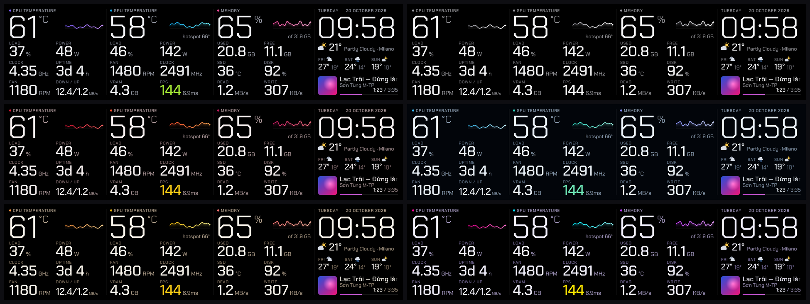

<div align="center">


# Trofeo Pro Dashboard

**A fast, good-looking system dashboard for the Thermalright Trofeo Vision LCD.**<br>
13 hand-built layouts · 6 color themes · landscape *and* portrait · live CPU / GPU / RAM / SSD / network · FPS · now-playing with album art · weather

[](../../releases/latest)
[](LICENSE)
[](#install)
[](https://www.rust-lang.org/)

[**Download**](../../releases/latest) · [Layouts](#layouts) · [Performance](#performance) · [Themes](#themes) · [Install](#install) · [Configure](#configure) · [FAQ](#faq)

</div>

---

## Why this exists

The official software is heavy and gives you one look. **Trofeo Pro Dashboard** is a small native
program (Rust, no browser, no runtime) that drives the panel directly over USB and gives you a gallery
of completely different designs — from a minimal giant-digits view to a retro synthwave sunset — all
showing the **same complete set of readings**. Pick one, change theme, or let it cycle.

It is built on top of the excellent open-source [`trofeo-lcd-rs`](https://github.com/haven80/trofeo-lcd-rs)
driver (see [Credits](#credits)) and adds a new "**pro**" renderer with smooth anti-aliased text, a
modern look and the layouts below.

## Highlights

- **13 layouts, 6 themes** — landscape designs for the 1920×462 panel and **5 portrait designs** for vertically mounted displays.
- **Everything on screen, always** — date & clock, weather with a 3-day forecast, CPU (temp, load, power, clock, fan, uptime, network down/up), GPU (temp, hotspot, load, power, fan, clock, VRAM, **FPS + frame-time**), RAM (used / free / total), SSD temperature and disk usage, SSD read / write.
- **Now playing** — album art, title (auto-scrolling when too long), artist, **elapsed / total time** and progress. Optionally the accent colors follow the cover art.
- **Pop-ups** — volume / mute overlay and a "new song" card appear for a few seconds, then disappear.
- **Light on your PC** — the dashboard only redraws when something actually changes (about once per second when idle) and uses well under 1% of a modern CPU (see [Performance](#performance)). Your games come first.
- **Unicode-ready font** — bundled *Chakra Petch* (futuristic, gaming look) with full **Vietnamese** and Latin-extended diacritics for song titles and artists.
- **Set-and-forget** — auto-reconnects when the USB cable is unplugged, optional start-with-Windows, **live config reload** (edit the file, see the change within a second).
- **Rotate through designs** — `pro_layout = all` cycles every landscape layout, `pro_theme = all` cycles every theme.

## Performance

The dashboard only redraws when something on screen actually changes (about once per second when idle), so it stays out of your way.

Measured on Windows 11 with a Ryzen 7 5700X3D (8 cores / 16 threads) and a Radeon RX 6900 XT, 30 seconds per layout, idle desktop (no game, no music playing). CPU time of all `trofeo_lcd.exe` processes:

| Layout | % of one thread | % of whole CPU |
|---|---:|---:|
| Focus | 7.1 | 0.45 |
| Bento | 7.4 | 0.46 |
| Dots | 7.3 | 0.46 |
| Equalizer | 7.8 | 0.49 |
| Blueprint | 8.2 | 0.51 |
| Terminal | 9.0 | 0.56 |
| Receipt | 10.0 | 0.63 |
| Chamfer | 10.2 | 0.64 |
| Synthwave | 10.2 | 0.64 |
| Classic | 10.3 | 0.64 |
| Lock | 11.7 | 0.73 |
| Cockpit | 13.2 | 0.83 |
| Rings | 14.3 | 0.90 |

Memory use is roughly 24-35 MB. Even the busiest layout stays under 1% of the whole CPU. Numbers will differ a little on other machines and while music or a game is running.

## Layouts

### Landscape

| | |
|---|---|
| **Focus** — giant digits, nothing else. Four calm columns: CPU · GPU · Memory · Clock/Weather/Music.<br> | **Classic** — the original rounded cards (3 styles: *cards*, *glass*, *flat*).<br> |
| **Cockpit** — twin automotive-style gauges for CPU and GPU, clock in the middle.<br> | **Bento** — saturated, colourful tiles in an Apple-keynote style.<br> |
| **Terminal** — a green-on-black console with ASCII bars and a shell prompt.<br> | **Chamfer** — angular HUD panels with slanted numerals, straight out of a sci-fi game.<br> |
| **Rings** — nested activity rings (load · temperature · clock) for CPU, GPU and memory.<br> | **Dots** — LED dot-matrix numerals on a clean black field.<br> |

### Portrait — for vertically mounted displays

Set `pro_rotate = cw` (or `ccw`) to match the direction you turned the screen.

<table>
<tr>
<td align="center" width="20%"><br><b>Lock</b><br><sub>phone lock-screen with frosted-glass cards over an aurora</sub></td>
<td align="center" width="20%"><br><b>Equalizer</b><br><sub>hi-fi LED level meters</sub></td>
<td align="center" width="20%"><br><b>Receipt</b><br><sub>thermal-paper receipt with a halftone cover and barcode</sub></td>
<td align="center" width="20%"><br><b>Synthwave</b><br><sub>retro sun, neon grid floor, glowing text</sub></td>
<td align="center" width="20%"><br><b>Blueprint</b><br><sub>technical drawing with a title block</sub></td>
</tr>
</table>

## Themes

Every layout follows the active color theme. Six are included — **nzxt**, **graphite**, **crimson**,
**arctic**, **ember**, **neon** — and any of them can be combined with any layout.



Turn on `pro_cover_color = true` and the accent colors are taken from the album art of whatever is playing.

## Install

### Windows (recommended)

1. Download **`trofeo-pro-dashboard-windows.zip`** from the [latest release](../../releases/latest) and unzip it anywhere you want to keep it.
2. Close the official TRCC software if it is running (two programs can't drive the LCD at once).
3. Double-click **`install.bat`** and accept the UAC prompt. This registers a *Scheduled Task* that starts the dashboard at every logon (elevated, so FPS capture works) and launches it now.
4. Double-click **`choose-layout.bat`** to pick a layout, theme and style. The screen updates instantly.

Uninstall: **`uninstall.bat`**. Restart the display: **`restart.bat`**. Preview a design without the hardware: **`preview.bat`**.

> **Windows Defender / SmartScreen** may warn about an unsigned executable. The binary is built from the
> source in this repository; you can also [build it yourself](#build-from-source).

Optional, for extra readings:

- **CPU fan RPM** — run [HWiNFO64](https://www.hwinfo.com/) and enable *Settings → Sensors → Shared Memory Support* (the free edition turns it off after 12 h).
- **AMD CPU temperature / power** — install [PawnIO](https://github.com/namazso/PawnIO) (see the [original guide](docs/UPSTREAM_README.md#usage)).

### Linux

Needs `pkg-config`, PulseAudio headers and `playerctl` (song titles). For USB access without `sudo`, install
`99-trofeo-lcd.rules`.

```bash
cargo build --release
./target/release/trofeo_lcd
```

### Build from source

```bash
git clone https://github.com/HuyBruh/trofeo-lcd-rs
cd trofeo-lcd-rs
cargo build --release          # trofeo_lcd, trofeo_screen, trofeo_config
```

The pro renderer is pure Rust (software rasteriser + [fontdue](https://github.com/mooman219/fontdue)); no GPU or browser is involved.

## Configure

Everything lives in `trofeo.conf` next to the executable and is **hot-reloaded** every second.

```ini
layout      = pro
pro_layout  = focus            # see the table below
pro_theme   = nzxt             # nzxt | graphite | crimson | arctic | ember | neon | all
pro_style   = cards            # cards | glass | flat   (classic / cockpit / focus only)
pro_rotate  = cw               # cw | ccw   (portrait layouts only)
pro_cover_color = true         # accent colors follow the album art
pro_song_popup  = true         # "new song" card
flip        = false            # true if the panel is mounted upside-down
weather_city = London, England # optional — default is auto-detect by IP
```

| `pro_layout` | Orientation | Look |
|---|---|---|
| `classic` `cockpit` `focus` | landscape | cards · twin gauges · giant digits |
| `bento` `terminal` `chamfer` `rings` `dots` | landscape | colour tiles · console · HUD · activity rings · LED matrix |
| `lock` `equalizer` `receipt` `synthwave` `blueprint` | portrait | lock screen · LED meters · receipt · retro sunset · blueprint |
| `all` | landscape | cycle through every landscape layout |
| `portrait` | portrait | cycle through the five portrait layouts |

Combine names with commas to build your own rotation, e.g. `pro_layout = focus, rings, dots` and set
`pro_theme_interval = 30` (minutes per theme). A full reference of the original options is in
[OPTIONS_GUIDE.md](OPTIONS_GUIDE.md) and the [upstream README](docs/UPSTREAM_README.md).

### Preview without hardware

```bash
trofeo_lcd --preview-png preview.png --preview-state music --config trofeo.conf
```

renders the current configuration to a PNG (`--preview-state idle|music`). Portrait layouts are saved as they appear on the rotated panel.

## FAQ

**Which displays are supported?** Developed and tested on the **Thermalright Trofeo Vision 9.16"** (1920×462, USB `0416:5408`). The driver also supports the 11.3" panel; the pro layouts scale to the panel size but have not been tuned on it.

**The picture is upside-down.** Set `flip = true`. For portrait layouts switch `pro_rotate` between `cw` and `ccw`.

**CPU fan shows `--`.** Enable *Shared Memory Support* in HWiNFO64 (see above).

**FPS shows `--`.** FPS is captured with ETW and needs the program to run as Administrator (the autostart task does this) while a DirectX game is in the foreground.

**Can I add my own design?** Yes — each layout is a single function in [`src/pro_designs.rs`](src/pro_designs.rs) that paints on a 1920×462 (or 462×1920) canvas with a few drawing helpers. Pull requests with new designs are very welcome.

## Credits

- Protocol and driver: [haven80/trofeo-lcd-rs](https://github.com/haven80/trofeo-lcd-rs) ← [sukualam/trofeo-lcd](https://github.com/sukualam/trofeo-lcd) ← [Lexonight1/thermalright-trcc-linux](https://github.com/Lexonight1/thermalright-trcc-linux). See [NOTICE.md](NOTICE.md).
- Font: [Chakra Petch](https://github.com/m4rc1e/Chakra-Petch) © The Chakra Petch Project Authors, SIL Open Font License 1.1 ([`assets/OFL.txt`](assets/OFL.txt)).
- Weather data: [Open-Meteo](https://open-meteo.com/).
- The pro dashboard, its 10 new designs and the portrait support were developed with AI assistance ([Claude](https://claude.ai)).

*This project is not affiliated with or endorsed by Thermalright.*

## License

[GPL-3.0-or-later](LICENSE).
